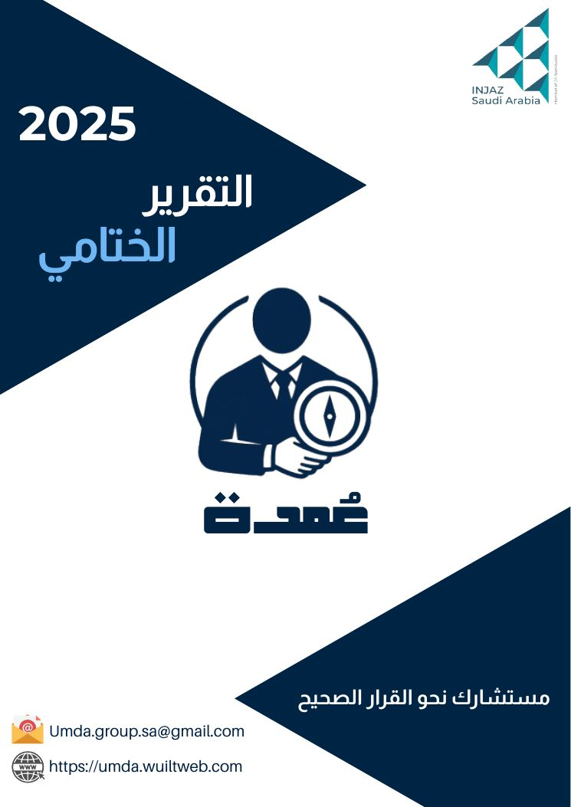
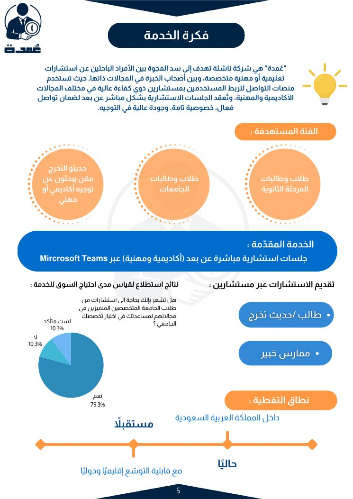
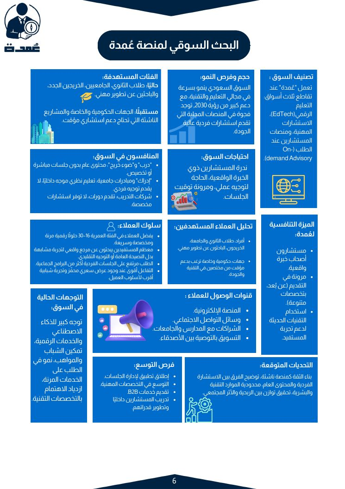
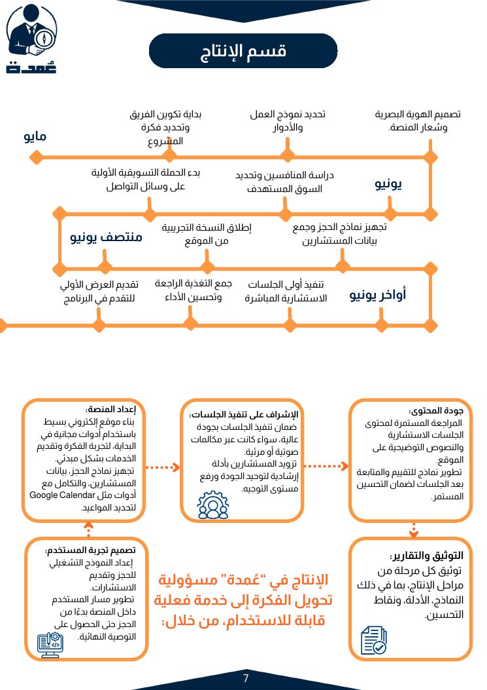
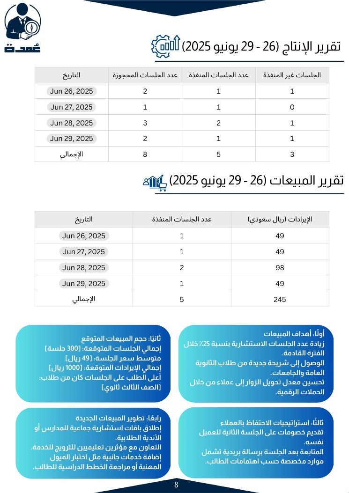
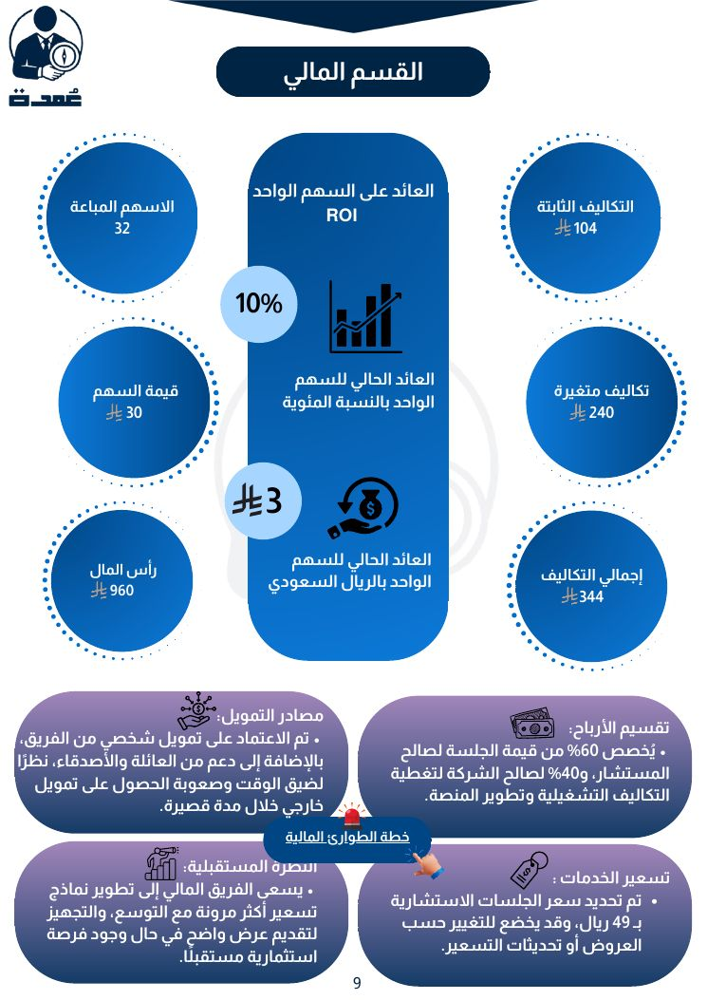
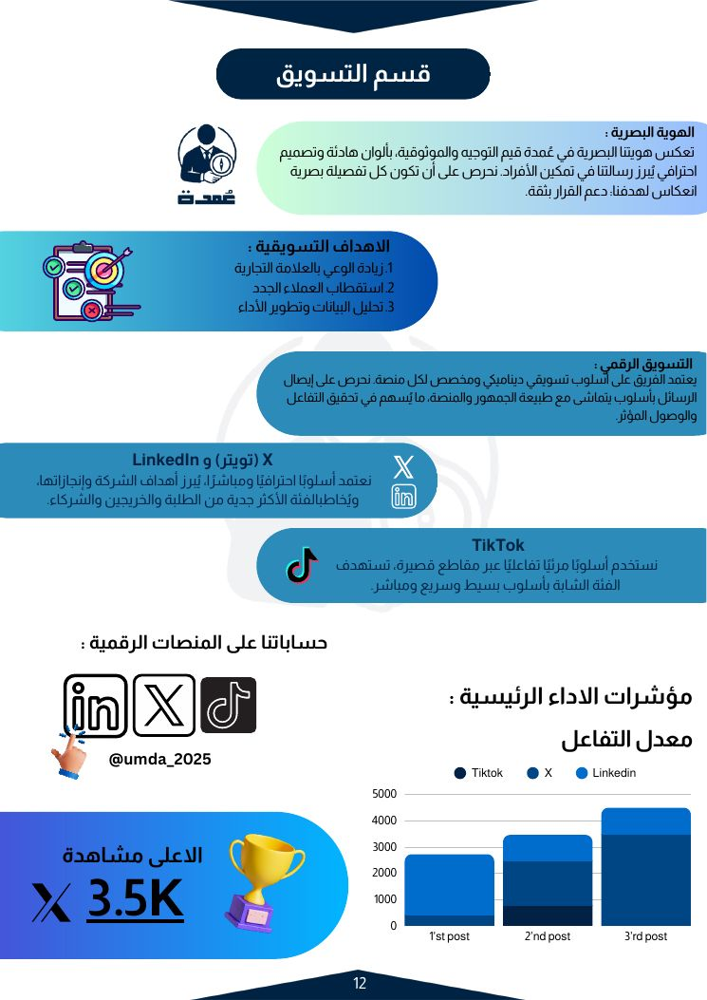

  

<h1 align="center">Umda | عُمدة</h1>

<b>"Your advisor toward the right decision"</b> 
A student startup that connected people facing big academic and career decisions with experienced consultants in the same field.

INJAZ Saudi Arabia Company Program · Supervised by the CCIS Innovation Center, Princess Nourah bint Abdulrahman University · 2025

---

## The Problem
Many high school students, university students, and graduates make life-changing decisions, like choosing a major or a career path, **without reliable guidance**. Existing platforms offer either general content with no personal follow-up, or expensive training that doesn't fit students' needs.

Our market survey confirmed the need: **79.3%** of respondents said they would want guidance from consultants who specialize in their field.

## Our Solution
**Umda** offers **one-on-one remote consultation sessions** over Microsoft Teams. Each session pairs the user with a consultant who has real experience in the field they're asking about.

**Who it serves**
- 🎓 Secondary school students choosing a major
- 🏛️ University students planning their path
- 💼 Graduates and career changers

**What made it different:** personalized, field-specific advice; verified consultants; easy online booking; affordable pricing (**49 SAR per session**).

## From Idea to Real Business
| Stage | What we did |
|---|---|
| **Research** | Market research, competitor analysis, customer surveys, SWOT and PESTEL analysis, Business Model Canvas |
| **Build** | Visual identity, website launch, booking forms, recruiting and onboarding consultants |
| **Launch** | Ran live paid consultation sessions |
| **Grow** | Marketing on X, LinkedIn, and TikTok, reaching **3.5K views** on X |
| **Close** | Formal evaluation, documentation, and an orderly shutdown of the company |

## Results
| Metric | Value |
|---|---|
| Sessions booked (Jun 26–29, 2025) | 8 |
| Sessions delivered | 5 |
| Revenue | 245 SAR |
| Capital raised | 960 SAR (32 shares × 30 SAR) |
| Total costs | 344 SAR |
| Return on investment | **10%** |

The company is also mapped to the UN **Sustainable Development Goals** (4, 5, 8, 9, 17) and Saudi **Vision 2030**.

## Inside the Report

  
  
  

  
  
  

## My Role: Co-founder & Chief Operating Officer (COO)
- **Co-founded** Umda with the team
- Served as **COO** from April 2025, leading day-to-day operations and overseeing most of the company's departments
- **Interviewed and selected** team members
- **Represented the company** in the competition

## Documents
- 📄 [Final report (Arabic)](docs/umda-final-report-ar.pdf): executive summary, organizational structure, market research, production, sales, financials, business plan, PESTEL, marketing, project management, SDGs, and reflection
